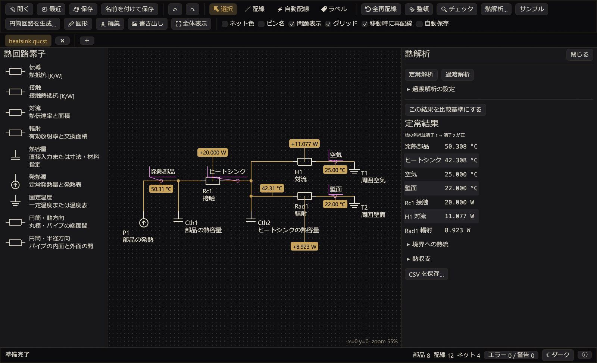

# Qucs-T ユーザーマニュアル

Qucs-T は、熱回路図を使って部品の温度と熱の流れを求める Windows アプリです。発熱する部品、ヒートシンク、周囲空気などを回路に配置し、温度が落ち着いた状態や、起動・停止後の変化を調べられます。

- [起動とファイル](#起動とファイル)
- [サンプルで解析を試す](#サンプルで解析を試す)
- [熱回路を作る](#熱回路を作る)
- [素子と入力単位](#素子と入力単位)
- [定常解析と過渡解析](#定常解析と過渡解析)
- [結果の確認と比較](#結果の確認と比較)
- [円筒回路を自動生成する](#円筒回路を自動生成する)
- [うまくいかないとき](#うまくいかないとき)
- [ショートカット](#ショートカット)
- [CLI と MCP](#cli-と-mcp)

## 起動とファイル

配布ファイルを展開し、`qucs-t.exe` を開きます。熱解析には Qucs-T 内蔵のソルバーが使われます。ソースからビルドする場合は、[README の起動手順](../README.md#起動)を参照してください。

| 目的 | 操作 |
| --- | --- |
| 空の回路を作る | タブ列の **＋** または `Ctrl+T` |
| 回路を開く | **開く** または `Ctrl+O` で `.qucst` を選ぶ |
| 回路を保存する | **保存** または `Ctrl+S` |
| 原本を残して別ファイルを作る | **名前を付けて保存** または `Ctrl+Shift+S` |

`.qucst` には、素子と配線、保存した解析設定、円筒の生成条件が入ります。解析結果を数値で残すには **CSV を保存…** を使います。回路の図を残すにはツールバーの **書き出し** から PNG、SVG、PDF を選べます。

回路を別のアプリや MCP から変更すると、編集中の内容と競合する場合があります。競合表示が出たら **変更を確認…** で内容を確認し、手元の編集を残したいときは別名で保存してください。

左のパレットから素子を選び、中央の回路図に配置します。配置した素子をクリックすると、右の **プロパティ** で値を編集できます。熱解析を開くと右側が解析パネルに切り替わります。プロパティに戻るには、解析パネルの **閉じる** を押します。

## サンプルで解析を試す

1. ツールバーの **サンプル** を押します。発熱部品とヒートシンクの回路が別タブに開きます。同じ回路は [heatsink.qucst](../examples/heatsink.qucst) にもあります。
2. **熱解析…** を開き、**定常解析** を押します。
3. **定常結果** で、発熱部品が約 **50.31 °C**、ヒートシンクが約 **42.31 °C** になることを確認します。周囲空気は **25 °C**、周囲壁面は **22 °C** です。
4. **定常結果** の枝の熱流で、対流が約 **11.08 W**、輻射が約 **8.92 W** と読めます。**熱収支** を開くと、発熱と放熱の合計がそれぞれ **20 W** であることを確認できます。
5. 同じタブで **過渡解析** を押し、**温度** の表示対象を **発熱部品** にします。発熱は **10–100 秒** と **150–240 秒** にオンになります。波形では、加熱中の温度上昇と停止後の冷却を確認できます。

## 熱回路を作る

回路図の **ノード** は、部品の表面や金属の塊など、同じ温度で扱う場所です。熱抵抗はノード間の熱の流れを表し、熱容量はノードに熱が蓄えられる量を表します。発熱源はノードへ熱を加え、固定温度素子は周囲空気や冷却板などの温度を指定します。

### ４素子で温度上昇を確認する

1. 新しいタブに **伝導**、**熱容量**、**発熱源**、**固定温度** を配置します。左のパレットで素子を選び、回路図上をクリックします。配置を終えるときは `Esc` を押します。
2. **伝導** の端子 1 に発熱源と熱容量をつなぎます。端子 2 に固定温度をつなぎます。
3. 素子を選択し、右の **プロパティ** で伝導を **2 K/W**、熱容量を **10 J/K**、発熱源の **定常発熱 [W]** を **5 W**、固定温度を **25 °C** に設定します。発熱入力は **一定** にします。
4. `L` で発熱側の配線またはピンをクリックし、`発熱点` と名付けます。
5. **定常解析** を実行すると **発熱点** が **35 °C** になります。共通初期温度を **25 °C** として過渡解析すると、**20 秒** 時点では約 **31.3 °C** になります。

~~~text
発熱源 5 W ─┐
            ├─ 発熱点 ── 伝導 2 K/W ── 固定温度 25 °C
熱容量 10 J/K┘
~~~

### 配線とプロパティの操作

- **配線**（`W`）で、始点、必要な折れ点、終点を順にクリックします。終点をクリックしたら、右クリックで確定します。
- **自動配線**（`A`）では、接続したい２つのピンを順にクリックします。分岐が必要なときは手動で配線を接続し、**チェック** で接続状態を確認します。
- **ラベル**（`L`）でノードに名前を付けます。離れた配線でも同名のネットラベルを使うと同じノードとしてつながります。別の温度として扱いたい位置には別の名前を付けます。
- 伝導、接触、対流、輻射、円筒の各抵抗は共通の２端子記号です。**表示ラベル** は図面上の文字、**計算モデル** は解析式を設定する欄です。モデルを切り替えると使用する入力欄が切り替わります。
- **ピン名** や **ネット色** を表示すると、熱流の向きや配線のつながりを確認できます。編集後は **チェック** と再解析を行います。

## 素子と入力単位

値の欄には、ラベルに示された単位で数値を入力します。例えば `軸長 [mm]` に 100 mm を指定する場合は `100` と入力します。

| 素子・計算モデル | 主な入力 | 使う場面 |
| --- | --- | --- |
| 伝導・接触 | 熱抵抗 `K/W` | 既知の熱抵抗、部品とヒートシンクの界面 |
| 伝導・寸法指定 | 伝熱距離 `mm`、熱流に垂直な断面積 `mm²`、熱伝導率 `W/(m·K)` | 断面積が一定の平板や棒 |
| 円筒・軸方向 | 軸長・内外半径 `mm`、熱伝導率 `W/(m·K)` | 丸棒やパイプの両端面間。中実なら内半径を `0` にする |
| 円筒・半径方向 | 軸長・内外半径 `mm`、熱伝導率 `W/(m·K)` | 中空円筒の内面から外面。内半径は正で外半径より小さくする |
| 対流 | 熱伝達率 `W/(m²·K)`、面積 `m²` | 固体表面と空気・冷却水などの間 |
| 輻射 | 有効放射率、交換面積 `m²` | 表面と周囲壁面などの間 |
| 熱容量 | 熱容量 `J/K`、任意の初期温度 `°C` | 部品や構造物の蓄熱 |
| 発熱源 | 定常発熱 `W`、任意の発熱表 | 電源投入や内部発熱 |
| 固定温度 | 温度 `°C`、任意の温度表 | 周囲空気、冷却板、加熱面などの温度を与える |

**熱容量** の **容量設定** では、直接入力に加えて **平板** と **円筒** を選べます。寸法、密度 `kg/m³`、比熱 `J/(kg·K)` から `密度 × 体積 × 比熱` で求めた容量がプロパティに表示されます。輻射では、入力した温度を絶対温度に換算して４乗則を計算します。

### 発熱表と温度表

発熱源の **発熱入力** を **発熱表** にすると、時刻 `s` と発熱量 `W` を１行ずつ入力できます。時刻は `0` から始めて昇順に並べ、各行の値は次の時刻まで保持されます。次の例では、10 秒から 100 秒まで 20 W を加えます。

~~~csv
0,0
10,20
100,0
~~~

固定温度素子の **温度入力** を **温度表** にすると、時刻 `s` と温度 `°C` を入力できます。点の間は線形補間し、最終行以降は最後の値を保持します。次の例では、30 秒から 60 秒までに冷却温度が 25 °C から 15 °C に変わります。

~~~csv
0,25
30,25
60,15
~~~

定常解析と、定常解から開始する過渡解析の事前計算には、素子の **定常発熱 [W]** と **温度 [°C]** の欄を使います。過渡解析を開始した後は、有効になっている時系列表を使用します。

## 定常解析と過渡解析

**熱解析…** または `F5` で解析パネルを開きます。

| 解析 | 確認できること | 選び方 |
| --- | --- | --- |
| **定常解析** | 時間が経って温度が落ち着いたときの各ノード温度と熱流 | 連続運転時の温度上限や放熱経路を検討する |
| **過渡解析** | 指定した初期状態からの温度・熱流の変化 | 起動、停止、繰り返し運転、温度上限に達する時刻を調べる |

定常解析では、熱的につながった回路の各グループに固定温度境界までの経路を設けてください。過渡解析では、熱容量があるグループなら、断熱された系の温度変化も計算できます。

**過渡解析の設定** では次の項目を指定します。

| 項目 | 説明 |
| --- | --- |
| 開始温度 | **初期温度** は共通初期温度を使い、素子で指定した初期温度で上書きします。**定常解** は事前に定常解析して、その温度から開始します |
| 共通初期温度 | 個別指定のない熱容量ノードの開始温度。新規回路の既定値は 25 °C |
| 終了時刻 | 解析を終える時刻。新規回路の既定値は 300 秒 |
| 最大出力間隔 | 結果を記録する時刻の最大間隔。発熱や境界温度の切り替え付近などでは、さらに細かい点が出力されます |
| 到達判定温度 | 温度波形で初回到達時刻を調べる基準温度 |

熱容量のない接点の温度は、その時刻の熱収支から決まります。設定だけ先に書き込む場合は **設定を回路図に適用** を押し、回路を保存します。設定や素子を変えた後は、解析を再実行します。

## 結果の確認と比較

### 温度・熱流・熱収支

定常解析では回路図に温度と枝の熱流が表示され、右の **定常結果** でも数値を確認できます。過渡解析では **温度**、**枝の熱流**、**境界の熱流**、**熱収支** を切り替え、表示対象を選びます。温度波形には最高温度と、到達判定温度への初回到達時刻が表示されます。

| 項目 | 見方 |
| --- | --- |
| 枝の熱流 `W` | 正は端子 1 から端子 2 への流れ。負は反対向き |
| 境界の熱流 `W` | 正は境界へ出ていく熱。負は境界から回路に入る熱 |
| 蓄熱速度 `W` | 正は回路に熱を蓄えている状態。負は回路の蓄熱が減っている状態 |
| 熱収支の差分 `W` | 発熱源合計と境界からの加熱を足し、境界への放熱と蓄熱速度を引いた値 |

**CSV を保存…** で全信号を書き出せます。時刻の列は秒、温度は °C、熱流と熱収支は W です。発熱の切り替え直前と直後が同じ時刻で記録される場合があります。

### 条件を変えた結果を比較する

1. 元の回路を解析し、**この結果を比較基準にする** を押します。
2. 素子値や解析条件を変え、同じ種類の解析を実行します。別タブで開いた回路の結果も使えます。
3. **比較基準** で最高温度と最大放熱の差を確認します。過渡解析では、**表示** と **基準** で信号を選ぶと、現在の波形と基準の波形が重なります。

比較基準はアプリを開いている間保持されます。

### 実測温度と比較する

1. 過渡解析を実行し、**温度** で測定位置に対応するノードを選びます。
2. **実測温度を重ねる** を開き、**実測 CSV を開く…** を押します。
3. **時刻列 [s]** と **温度列 [°C]** を選びます。グラフの点にカーソルを合わせると、その測定時刻での **解析値 − 実測値** が表示されます。

CSV は UTF-8 のカンマ区切りです。時刻は昇順、温度は数値で指定します。見出しは任意で、温度が空欄の行は除外されます。下の例では、同じ時刻に測った２地点から温度列を選べます。

~~~csv
時刻,発熱点,ヒートシンク
0,25.0,25.0
10,25.1,25.0
30,37.5,31.2
60,44.1,37.8
~~~

実測データはタブを開いている間、再解析しても保持されます。表示を解除するときは **実測を外す** を押します。

## 円筒回路を自動生成する

### 片端を加熱し、外面を冷却する

1. **円筒回路を生成…** を開き、軸長、内半径、軸方向の分割数を指定します。
2. **層と材料** で外半径、半径方向の分割数、熱伝導率、密度、比熱を指定します。例えば、軸長 **100 mm**、内半径 **5 mm**、外半径 **10 mm**、軸方向 **3 分割**、半径方向 **2 分割** から試せます。
3. **片端加熱＋外面対流** を押します。**表面条件** で端面 A の発熱量、外面の流体温度と熱伝達率を確認します。
4. **新しいタブに生成** を押し、生成した回路で **定常解析** または **過渡解析** を実行します。

各セル間に軸・半径方向の熱抵抗、各セルに熱容量が配置されます。端面、内面、外面の条件は、図面上の同名のネットラベルで壁面につながります。対流・輻射の面積と、発熱を各区間に配分する割合は寸法から計算されます。

### 多層円筒と表面条件

- **外側に層を追加** で、管の外側に断熱材や外装を追加できます。外側に向かって外半径を大きくし、層ごとに材料と半径方向の分割数を指定します。
- 外側の層を選ぶと、**内側の層との接触熱抵抗 [m²·K/W]** を入力できます。正の値を指定すると接触素子が配置され、温度結果に `界面…内側` と `界面…外側` が現れます。既定値 `0` では両側が同じ温度になります。
- **材料を登録／更新** で層の材料を保存します。別の回路を生成するとき、**登録材料を適用…** から再利用できます。
- **表面条件** では、端面 A・B、内面、外面ごとに断熱、固定温度、発熱、対流、輻射、または対流と輻射の併用を選べます。発熱や温度の表もここで設定できます。
- 中実円筒では内半径を `0` にします。軸方向の分割数と、全層の半径方向分割数の合計を掛けた値は **256 セル以下** にします。

生成回路を保存してから **円筒回路を生成…** を開くと、保存済みの生成条件を読み込めます。寸法や分割数を変えて、別タブに再生成できます。生成後に手で変更した配線や素子値を使うときは、その回路図を保存して解析します。

### 温度マップとスイープ

**温度マップ…** で、生成した円筒の軸位置・半径に対するセル温度を確認できます。過渡解析では時刻を動かせます。温度マップ上の位置をクリックして観測点を固定し、**この位置の過渡波形を表示** を押すと、対応する温度信号を選べます。別の円筒解析を比較基準に設定している場合は、同じ物理位置のセル同士を比較できます。

**生成条件のスイープ** では、生成画面の条件をベースにして、最外層の厚さ、外面の熱伝達率、または両方向の分割倍率を変更できます。

1. 変更する項目と、**定常** または **過渡** を選びます。
2. 開始値、終了値、試行数を入力します。外面の熱伝達率を変える場合は、外面の表面条件で対流を有効にします。
3. 比較する観測点の軸位置と半径を入力し、**スイープを実行** を押します。
4. **最高温度**、**最大放熱**、**観測点最高** を比較します。**観測点最高** は、指定した物理位置を含むセルの温度です。過渡解析の場合は解析期間内の最高値を示します。**スイープ CSV を保存…** で結果を出力できます。

分割倍率を変える場合は、観測点の温度と放熱量がどの程度変わるかを確認してください。過渡スイープには、現在の回路図に適用済みの解析設定が使われます。

## うまくいかないとき

| 状況 | 確認すること |
| --- | --- |
| 「固定温度境界への経路がありません」と出る | 表示されたノードから固定温度素子までの配線と熱抵抗の経路を確認します。円筒の場合は表面条件で固定温度や対流などを設定します |
| 配線が重なって見えるのに温度がつながらない | **チェック** で未接続ピンを調べます。自動配線し直すか、手配線でピンや分岐を接続します |
| 同じノードの境界温度や初期温度が異なる | 同名ラベルで接続された箇所を確認します。同じノードに置いた境界の温度・温度表や、複数の熱容量の初期温度をそろえます |
| 熱流の符号が想定と違う | **ピン名** を表示して端子 1 と 2 の向きを確認します。境界の熱流は境界へ出る向きが正です |
| 解析が収束しない | 入力単位、温度、熱抵抗、熱容量、発熱量を確認します。寸法指定では半径や面積の関係も確認します |
| 過渡解析の出力や円筒の分割数が上限に達する | 解析時間または最大出力間隔を調整します。円筒では全体で 256 セルに収まるよう分割数を調整します |
| CSV が読み込めない、または実測と解析の時間がずれる | UTF-8 のカンマ区切りで保存し、時刻列が昇順の秒、温度列が °C になっているかを確認します。解析と実測で時刻の原点をそろえます |

## ショートカット

| キー | 操作 |
| --- | --- |
| `Ctrl+T` / `Ctrl+W` | 新規タブ / 現在のタブを閉じる |
| `Ctrl+Tab` | 次のタブへ |
| `Ctrl+O` / `Ctrl+S` / `Ctrl+Shift+S` | 開く / 保存 / 名前を付けて保存 |
| `Ctrl+Z` / `Ctrl+Y` | 元に戻す / やり直す |
| `Ctrl+C` / `Ctrl+V` / `Ctrl+D` | コピー / 貼り付け / 複製 |
| `W` / `A` / `L` | 手配線 / 自動配線 / ネットラベル |
| `R` / `M` / `Delete` | 回転 / ミラー / 選択項目の削除 |
| `Esc` | 選択ツールへ戻る |
| `F` / `Ctrl+0` | 回路全体を表示 |
| `Ctrl++` / `Ctrl+-` | 拡大 / 縮小 |
| `F5` | 熱解析パネルを開く |

回路図上でマウスホイールを回すと拡大・縮小し、中ボタンまたは右ボタンでドラッグすると表示範囲を移動できます。

## CLI と MCP

計算を繰り返し実行したい場合、配布フォルダーで PowerShell を開いて次のように実行できます。最後のファイル名を省略すると、結果は標準出力に JSON で返ります。

~~~powershell
.\qucs-t.exe steady .\examples\heatsink.qucst
.\qucs-t.exe transient .\examples\heatsink.qucst results.csv
~~~

MCP 対応クライアントからは回路の作成、編集、生成、解析、結果取得を操作できます。[接続設定](../README.md#mcp)と[MCP ツール一覧](mcp-tools.md)を参照してください。
